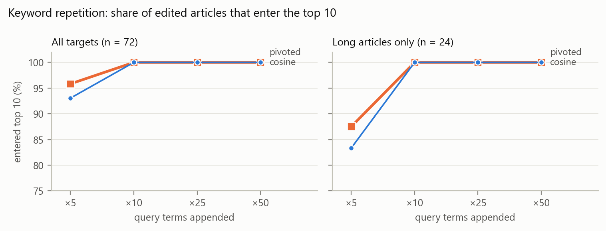
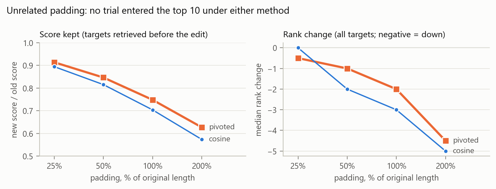
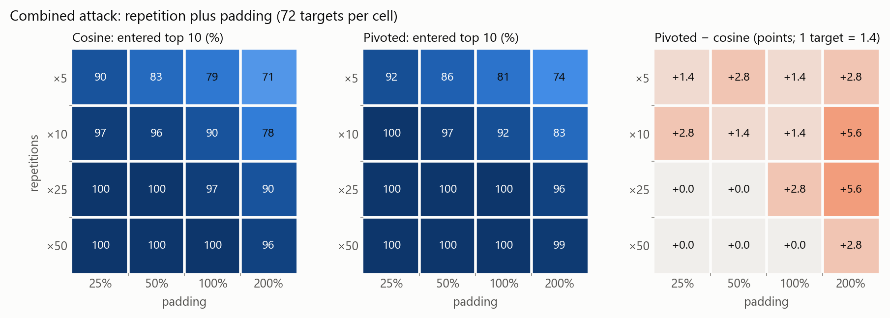
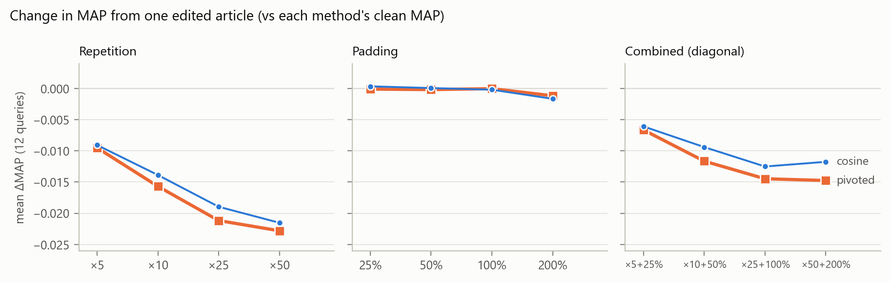

# Attack experiments: keyword repetition, padding, and both combined

```
python run_attacks.py
python plot_attacks.py
```

`run_attacks.py` runs in about 25 seconds. It prints every table on this page and writes
`results/attacks/{targets, trials, levels, by_group, by_query}.csv` and `summary.json`.
`plot_attacks.py` reads those CSVs and writes the four figures to `docs/figures/`
(PNG and PDF). The attack code is in `irengine/attacks.py`; its checks are in
`tests/test_attacks.py`.

**Setup** (unchanged from the main evaluation, `docs/epc_evaluation.md`)
- Engine: Porter stemming, lnc.ltc weights, title + body indexed. Slope **s = 0.8**
  from `frozen_slope.json`. Pivot **p = 33.128197**, from the clean collection.
- Labels: `qrels_final.csv` (frozen 2026-10-24), checked against its SHA-256 before
  running. Clean MAP: cosine 0.7109, pivoted 0.7289.

## Design

This follows step 4 of the proposal and section 4 of the intermediate report. Points
1–5 are fixed by them; the rest are choices made before running.

1. **Targets** are non-relevant for the query and outside the top 10 under both cosine
   and pivoted (an article with score 0 counts as outside).
2. **The same targets are used for both methods**, and each trial edits one article.
3. **Original documents and labels are kept.** An edited article stays non-relevant.
4. **IDF, N and the pivot stay at their clean values.** Only the edited article's
   weights (1 + ln tf) and norm are recomputed. Under lnc.ltc documents carry no IDF,
   so a fixed IDF only affects the query weights. (The proposal used TF·IDF on both
   sides, where fixing IDF would also affect document weights; the intermediate report
   records the switch to lnc.ltc.) Recomputing collection-wide statistics remains a
   stretch goal.
5. **Recorded per trial:** the words and tokens added, the target's old and new rank
   under each method, whether it entered the top 10, and the change in retrieval quality.
6. **Target sample:** 2 articles from each length group (short / medium / long, the
   tertiles of `docs/epc_evaluation.md`) per query, drawn with seed 15:
   12 × 6 = **72 targets**. Length is what separates the two methods, so each group gets
   the same number. 29 of the 72 are not retrieved at all before the attack.
7. **Not retrieved = rank 101** (N + 1), so a rank change can always be computed.
8. **Repetition** appends the query's terms, meaning its words after stopword removal,
   unstemmed and in query order, k = 5, 10, 25 or 50 times. Q1 adds 1 word per
   repetition and Q9 adds 8. Scores are the same as appending the full query, since
   stopwords are dropped, but the added-word counts are not inflated by "what", "the" etc.
9. **Padding** adds 25, 50, 100 or 200% of the article's body word count (the
   manifest's `word_count`, the same measure as the length groups), rounded half up.
   The text comes from body sentences of the other articles that are not relevant
   for the query. Any sentence containing a query stem is dropped, and an assertion
   checks every padding text, so no padding contains a query term. Natural text is
   used because one filler sentence repeated would barely raise the norm under 1 + ln tf.
10. **Padding is shuffled with a seed per (query, target)** and cut at the exact word
   count. Each level is the start of the same shuffled text, so 25% is part of 50%,
   and the combined attack uses the same padding as padding alone.
11. **Combined attack: the full 4 × 4 grid** of repetitions × padding levels.
   Repetition comes first, then padding, and the padding % is of the original length.
   The tables below show the diagonal (×5+25%, ×10+50%, ×25+100%, ×50+200%).
12. **Retrieval quality:** ΔAP and ΔP@10 for the attacked query, and **ΔMAP over all
   12 queries** with the edited article in place (several queries share terms such as
   `student`, `union` and `promis`). Each method is compared with its own clean MAP.
13. **Comparing the methods on the same targets:** for each target, under which method
   did the edit move it up more (rank change)? An exact two-sided sign test drops ties.
   For the combined grid the cells reuse the same targets, so the test is run per
   target, not per trial.
14. **New/old score** is reported for the 43 targets retrieved before the edit. For the
   others the ratio is undefined.

**Built-in checks** (`tests/test_attacks.py`, and at the end of `run_attacks.py`):
an empty edit reproduces the clean scores exactly for all 100 × 12 pairs; IDF, N, the
pivot and every other norm are unchanged after an attack; at s = 1 pivoted equals cosine
on edited articles; padding never contains a query stem and **never raises a score**
(the dot product stays the same while the norm grows). No padding-only trial entered
the top 10 or raised a score.

## Results

Each row has 72 trials per method. c/p = cosine/pivoted. "Moved up more" counts
targets where the edit's rank change was larger under pivoted / under cosine / equal.

### Keyword repetition

| Attack | Words added (mean) | Entered top 10 % c/p | Median new rank c/p | New/old score c/p | Mean ΔMAP c/p | Moved up more p/c/= | Sign p |
|---|---:|---:|---:|---:|---:|---:|---:|
| ×5 | 21 | 93.1 / 95.8 | 2 / 2 | 17.1 / 17.2 | −0.0091 / −0.0095 | 14/13/45 | 1.00 |
| ×10 | 42 | 100 / 100 | 1 / 1 | 21.2 / 21.3 | −0.0139 / −0.0157 | 16/9/47 | 0.23 |
| ×25 | 106 | 100 / 100 | 1 / 1 | 26.3 / 26.6 | −0.0190 / −0.0212 | 15/9/48 | 0.31 |
| ×50 | 212 | 100 / 100 | 1 / 1 | 30.1 / 30.5 | −0.0215 / −0.0228 | 11/10/51 | 1.00 |

Words added per repetition range from 1 (Q1, Q2) to 8 (Q9, Q10); ×50 adds 50 to 400 words.



### Unrelated padding

| Attack | Words added (mean) | Entered top 10 % c/p | Median new rank c/p | New/old score c/p | Median rank change c/p | Mean ΔMAP c/p | Moved up more p/c/= | Sign p |
|---|---:|---:|---:|---:|---:|---:|---:|---:|
| 25% | 441 | 0 / 0 | 78.5 / 78 | 0.894 / 0.914 | 0 / −0.5 | +0.0003 / −0.0001 | 19/9/44 | 0.087 |
| 50% | 882 | 0 / 0 | 82.5 / 82 | 0.815 / 0.846 | −2 / −1 | +0.0001 / −0.0002 | 23/6/43 | 0.002 |
| 100% | 1,763 | 0 / 0 | 84.5 / 84 | 0.704 / 0.748 | −3 / −2 | −0.0002 / −0.0000 | 25/7/40 | 0.002 |
| 200% | 3,525 | 0 / 0 | 89.5 / 86.5 | 0.574 / 0.627 | −5 / −4.5 | −0.0017 / −0.0012 | 26/4/42 | 0.0001 |

For padding, "moved up more" means "lost fewer places". About 56% of padding words
survive stopword removal (200% padding adds 1,979 indexed tokens on average).



### Combined attack

| Attack | Words added (mean) | Entered top 10 % c/p | Median new rank c/p | New/old score c/p | Mean ΔMAP c/p | Moved up more p/c/= | Sign p |
|---|---:|---:|---:|---:|---:|---:|---:|
| ×5 + 25% | 462 | 90.3 / 91.7 | 3 / 3 | 15.4 / 15.8 | −0.0061 / −0.0066 | 16/8/48 | 0.15 |
| ×10 + 50% | 924 | 95.8 / 97.2 | 2 / 2 | 17.4 / 18.2 | −0.0094 / −0.0116 | 19/8/45 | 0.052 |
| ×25 + 100% | 1,869 | 97.2 / 100 | 1.5 / 1 | 19.0 / 20.3 | −0.0125 / −0.0145 | 26/8/38 | 0.003 |
| ×50 + 200% | 3,738 | 95.8 / 98.6 | 2 / 1 | 18.0 / 19.7 | −0.0118 / −0.0148 | 32/7/33 | 0.0001 |

Entered top 10 (%) over the full grid (rows: repetitions, columns: padding):

| cosine | 25% | 50% | 100% | 200% | | pivoted | 25% | 50% | 100% | 200% |
|---|---:|---:|---:|---:|---|---|---:|---:|---:|---:|
| ×5 | 90.3 | 83.3 | 79.2 | 70.8 | | ×5 | 91.7 | 86.1 | 80.6 | 73.6 |
| ×10 | 97.2 | 95.8 | 90.3 | 77.8 | | ×10 | 100 | 97.2 | 91.7 | 83.3 |
| ×25 | 100 | 100 | 97.2 | 90.3 | | ×25 | 100 | 100 | 100 | 95.8 |
| ×50 | 100 | 100 | 100 | 95.8 | | ×50 | 100 | 100 | 100 | 98.6 |

Pivoted is equal or higher in all 16 cells. Over the grid, 22 trials succeeded under
pivoted only and none under cosine only (12 long targets, 6 short, 4 medium). Per
target: 15 targets entered the top 10 in more cells under pivoted, 0 under cosine and
57 in the same number (sign test p = 6.1 × 10⁻⁵).



### By length group

24 trials per group and method. Entered top 10 (%) c/p for repetition and combined;
median rank change c/p for padding.

| Attack | short | medium | long |
|---|---:|---:|---:|
| ×5 | 100 / 100 | 96 / 100 | 83 / 88 |
| ×10, ×25, ×50 | 100 / 100 | 100 / 100 | 100 / 100 |
| ×5 + 25% | 100 / 100 | 96 / 96 | 75 / 79 |
| ×10 + 50% | 100 / 100 | 100 / 100 | 88 / 92 |
| ×25 + 100% | 100 / 100 | 100 / 100 | 92 / 100 |
| ×50 + 200% | 100 / 100 | 100 / 100 | 88 / 96 |
| pad 25% | 0 / −0.5 | 0 / 0 | −1 / −1 |
| pad 50% | −2 / −1 | −0.5 / −0.5 | −3 / −1.5 |
| pad 100% | −2.5 / −1.5 | −1.5 / −1 | −5.5 / −4 |
| pad 200% | −4 / −3.5 | −3.5 / −3 | −6.5 / −6 |

### By query

Targets entering the top 10, out of 6, c/p:

| Query | ×5 | ×10 | ×25 | ×50 | ×5+25% | ×10+50% | ×25+100% | ×50+200% |
|---|---:|---:|---:|---:|---:|---:|---:|---:|
| Q1 | 5/5 | 6/6 | 6/6 | 6/6 | 4/4 | 5/5 | 6/6 | 5/6 |
| Q2 | 6/6 | 6/6 | 6/6 | 6/6 | 6/6 | 6/6 | 6/6 | 6/6 |
| Q3 | 6/6 | 6/6 | 6/6 | 6/6 | 6/6 | 6/6 | 6/6 | 6/6 |
| Q4 | 5/5 | 6/6 | 6/6 | 6/6 | 4/5 | 5/6 | 5/6 | 5/6 |
| Q5 | 3/5 | 6/6 | 6/6 | 6/6 | 3/3 | 5/5 | 5/6 | 5/5 |
| Q6–Q12 | 6/6 | 6/6 | 6/6 | 6/6 | 6/6 | 6/6 | 6/6 | 6/6 |

Median rank change under padding, c/p:

| Query | 25% | 50% | 100% | 200% |
|---|---:|---:|---:|---:|
| Q1, Q2, Q3, Q8 | 0 / 0 | 0 / 0 | 0 / 0 | 0 / 0 |
| Q4 | −2 / −3 | −4.5 / −4.5 | −6 / −7 | −9.5 / −10.5 |
| Q5 | −1 / −0.5 | −3.5 / −2 | −4.5 / −4 | −6.5 / −6 |
| Q6 | −0.5 / −0.5 | −0.5 / −0.5 | −0.5 / −0.5 | −0.5 / −0.5 |
| Q7 | 0 / −0.5 | −1.5 / −1 | −2.5 / −2 | −4.5 / −4 |
| Q9 | −1.5 / −1.5 | −2 / −2 | −4 / −3.5 | −8.5 / −6.5 |
| Q10 | −1.5 / −2 | −4.5 / −3 | −7.5 / −5.5 | −10 / −8.5 |
| Q11 | −4 / −2 | −6.5 / −4 | −11 / −8 | −15.5 / −13 |
| Q12 | −4 / −2.5 | −6.5 / −5.5 | −9 / −9 | −12.5 / −11 |

Q1, Q2, Q3 and Q8 show no change because at least 4 of their 6 targets (all 6 for Q1
and Q2) are not retrieved at all: a score of 0 stays 0, and the rank stays 101.

### Retrieval quality



- **One edited article costs 0.01–0.02 MAP** under repetition or the combined attack.
  For the attacked query alone the loss is large: mean ΔAP is −0.18 (cosine) and −0.20
  (pivoted) under repetition, because the edited article usually lands at rank 1.
- **P@10 of the attacked query falls less often under pivoted** (repetition: in 24 trials
  vs 47 for cosine). An article entering the top 10 pushes out the 10th, and P@10 falls
  only when that one was relevant.
- **Padding barely changes MAP on average** (mean ΔMAP within ±0.002; single trials
  range from −0.024 to +0.017). A padded article only falls. For the attacked query
  that can lift a relevant article behind it. But the article may be relevant for
  another query, and falling there lowers that query's AP.
- An edited article also changes AP for up to 4 other queries. On average that's 0.4–0.5
  other queries with repetition, 1.4 with padding, and 1.6–1.7 combined.

## Findings

- **Keyword repetition defeats both methods.** Five copies of the query terms (21 words
  on average) put 93% (cosine) and 96% (pivoted) of targets into the top 10, usually at
  rank 1 or 2. From ×10, every target gets in under both methods. Pivoting does not
  protect against repetition, and does not make it worse to a measurable degree
  (sign p ≥ 0.23).
- **Why the methods agree on repetition:** repetition barely changes the norm (one Q5
  target: 26.6 → 27.1 at ×5), so how each method normalizes length hardly matters. The
  score rises because the dot product rises.
- **Padding alone never succeeds, but it hurts pivoted less.** At 200% padding, pivoted
  keeps 63% of the target's score and cosine 57%; the target loses fewer places under
  pivoted for 26 targets and under cosine for 4 (p = 0.0001). This is guaranteed by the
  formulas: if the norm grows from n to n′, cosine keeps n/n′ of the score and pivoted
  keeps (0.2p + 0.8n)/(0.2p + 0.8n′), which is always larger.
- **So the combined attack is more effective under pivoted.** It is equal or better in
  all 16 cells of the grid, and 15 targets did better under pivoted against none under
  cosine (p = 6 × 10⁻⁵). The gap grows with padding, up to 5.6 points at 200%. This
  answers the question raised in the intermediate report: pivoting's milder length
  penalty does make the combined attack more effective, though the effect is small
  next to repetition itself.
- **Long articles resist the attack most, and pivoting narrows that gap.** At ×5 + 25%,
  75% (cosine) and 79% (pivoted) of long targets enter the top 10, against 100% of short
  ones. 12 of the 22 pivoted-only successes are long articles. This is the same shift
  towards long articles as in the main evaluation (step 39), now working for the attacker.

## Limitations

- 12 queries and 72 targets. Success saturates at 100% from ×10, so differences between
  the methods can only show at ×5 and in the combined grid.
- Targets are random within each length group, not "near misses". 29 of 72 start with
  score 0, so they depend entirely on the appended terms.
- The appended text is crude: a block of repeated query terms is easy to detect. The
  attack measures what the scoring formula allows, not what a careful attacker would do.
- IDF and the pivot are frozen, which isolates the edit but ignores that an edited
  article would change df and the mean norm (the stretch goal).
- Sign tests treat targets as independent, but the 6 targets of a query share its terms.
  The cells of the combined grid reuse the same targets, so they are not 16 independent
  results.
- Padding comes from the same collection, so it shares the collection's vocabulary and style.
